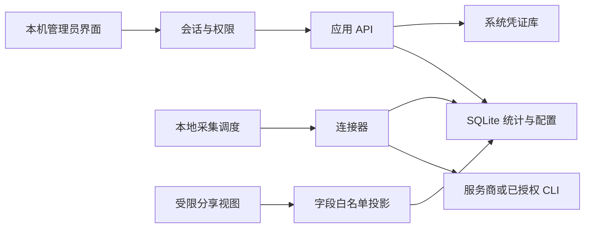

# 本地优先架构与数据契约

## 演进选择

保留 FastAPI 与现有前端，先拆分连接器和数据模型，不为商业化先重写框架。单设备部署优先 SQLite 作为事实存储，Redis 只作为可选缓存；未来团队版是否切 PostgreSQL 由并发与部署方式决定。

服务器 API Key 不能替代会员登录；配额读取不能替代完整费用账单。团队不汇总不同窗口、币种、单位的数字为一个“总额度”。

## 核心对象（目标契约，尚未实现）

- Account：id、provider、label、ownership(personal/work)、credential_ref、capabilities、status、created_at。
- Connection：id、account_id、adapter_version、auth_type、health、last_success_at、last_error_code；不返回 token。
- QuotaSnapshot：id、account_id、source、scope、windows、captured_at、last_success_at、status、error_code、schema_version。
- Window：id、unit(percent/tokens/requests/credits)、used、limit、remaining、used_percent、reset_at(UTC ISO8601)、period_start/end；未知字段为 null。
- CostRecord：account_id、currency、amount(nullable)、basis(official/estimated/unknown)、price_version、period、coverage；不能把未知价格写成 0。
- LocalUsage：account_id、request_id、input/output_tokens、occurred_at、source=workbench；默认不含提示词或响应正文。
- ShareView：id、selected_account_ids、allowed_fields、token_hash、expires_at、revoked_at；公开端点仅按白名单投影。

每个响应携带 provenance：official_api / local_cli / local_record / manual；coverage：subscription_window / provider_api / workbench_only。UI 必须显示范围与新鲜度，手工记录必须标记手工。

## 连接器接口

`capabilities() -> CapabilitySet`；`check_auth(account) -> Health`；`fetch_quota(account) -> QuotaSnapshot`；可选 `fetch_cost(account, range)`。不支持的能力显式声明 unsupported，不抛出通用“网络失败”。

错误分类：not_configured、needs_auth、forbidden、unsupported、rate_limited、network_error、provider_error、schema_changed。凭证只在服务端解析；错误正文先脱敏，日志记录关联 ID。保持每账号缓存、凭证指纹隔离；成功快照可在失败时回退但保留原时间并标 stale。

## 调度与数据

本地进程调度，浏览器关闭仍可运行；按连接器限速、超时、指数退避、抖动和同账号请求合并。缓存 TTL 与采集间隔分开定义；TTL=0 不代表无限频率。断网不删除有效历史。只读分享请求不得触发云端采集。

从 Redis/文件迁移：先导出备份 → dry-run 比较账号/记录/快照数量 → 新库事务导入 → hash/计数核验 → 显式切换存储 → 保留旧数据只读以便回滚。迁移完成后禁止静默双写或自动切回旧存储。

## 边界

本地管理员认证与 Host/Origin 校验优先；生产启动关闭代理头信任。API 体验自定义 endpoint 需要 SSRF 设计：默认 HTTPS、拒绝内网/metadata/本地地址，重定向重新校验；本地模型端点通过显式本地连接类型授权，不一概禁用正常本地使用。

macOS 优先系统钥匙串；Linux 需安全凭证库或明确主密码加密方案。加密密钥不与密文同目录保存。迁移前备份，失败可回退；不擅自清除用户在其他 CLI 中的凭证。

分享令牌按视图授权、到期、可撤销；LAN HTTP 仅用于受信网络，跨网络部署需 TLS 与正式身份方案。个人账号默认不共享，用户可主动选择。提示词日志默认关闭，诊断包默认脱敏、本地预览后再由用户决定是否发送。

许可证仅控制产品功能，不参与第三方认证；离线验证失败或续费到期不能删除记录或禁止导出。
